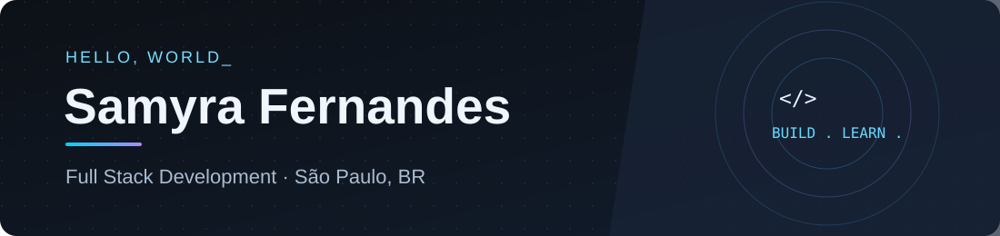

 

 

### About me

I'm **Samyra**, a student and developer from São Paulo, Brazil. I enjoy building web applications, exploring backend architecture, and making interfaces that feel good to use.

- 💻 **Currently focused on:** Full Stack Development with Angular, NestJS and TypeScript
- ☁️ **Exploring:** cloud, deployment, and software architecture
- 🎧 **Outside of code:** rock, MPB, pop, karaoke, and games

### Tech stack

### GitHub at a glance

### Education

- 🎓 **ETEC de Guarulhos** — Systems Development · 2024–2026
- ⚡ **SENAI Hermenegildo Campos de Almeida** — Electrical Maintenance · 2024–2025

---

**Let's build something interesting.**

<a href="https://www.linkedin.com/in/samyra-fernandes/">Connect on LinkedIn</a> · <a href="https://github.com/SamyNandes?tab=repositories">Explore my repositories</a>

